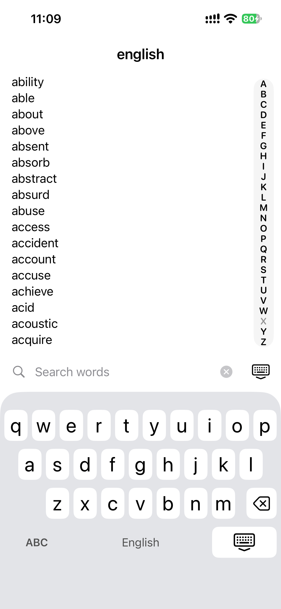
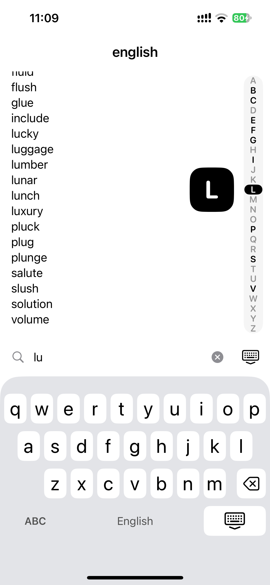

# BIP39

오프라인에서 BIP-39 니모닉 영문 단어를 간편하게 찾아보는 iPhone 앱입니다.
앱이 비활성화되는 즉시 검색 내용을 초기화하며, 앱은 검색 기록을 저장하거나 전송하지 않습니다.
iOS 17 이상, 세로 화면을 지원합니다.

<p align="center"></p>

## 실행

`BIP39.xcodeproj`를 Xcode에서 열고 BIP39 scheme으로 실행한다. 실기기용 개발 팀은 `project.yml`에 설정되어 있으며, 다른 계정으로 실행할 때는 해당 팀을 자신의 Signing Team으로 변경한다.

프로젝트 설정 변경 후에는 `xcodegen generate`로 재생성한다. 외부 패키지와 서버는 없다.

```sh
xcodebuild -project BIP39.xcodeproj -scheme BIP39 \
  -destination 'platform=iOS Simulator,name=iPhone 17e,OS=26.5' \
  -derivedDataPath .build/DerivedData test
```

## 동작

- 전체 2,048개 단어를 원본 순서로 표시한다.
- 오른쪽 아래 검색 버튼으로 앱 전용 영문 QWERTY 패널을 연다.
- 영문 키의 폭·행 간격·들여쓰기와 키보드 전체 높이는 기본 iPhone 영문 키보드 배치에 맞춘다. iPhone 13 기준 하단 안전 영역을 포함해 301pt이며, 하단에는 영문 전용 표시와 닫기 버튼을 둔다.
- 오른쪽 A–Z 막대를 누르거나 드래그하면 해당 글자로 시작하는 첫 단어로 이동한다. 드래그 중에는 선택 글자를 크게 표시하고 글자가 바뀔 때 가볍게 진동한다. 검색 중에도 현재 결과 안에서 이동하며, 결과가 없는 글자는 다음 유효 글자로 연결한다. 뒤에 유효한 글자가 없으면 마지막 유효 글자로 이동한다.
- 좁은 화면에서 키보드가 열려 막대가 짧아지면 일부 글자를 점으로 표시한다. 전체 26개 위치는 유지하고 선택 중에는 해당 글자를 확대한다. VoiceOver에서는 막대를 위아래로 조절해 이동할 수 있다.
- 검색은 접두어가 아닌 연속 문자열 포함 조건이다. `act`는 `abstract`, `practice`도 찾는다.
- 소문자 a–z 최대 8자만 입력한다. 삭제 키는 한 글자 삭제, X는 전체 지우기, 키보드 닫기는 검색 초기화다.
- 단어는 보기만 제공하며 복사·선택·공유·붙여넣기·문구 조합 기능이 없다.

## 개인정보 보호 범위

검색은 메모리에서만 처리하며 앱은 검색어·결과·히스토리를 파일, 환경설정, Keychain, 로그, 네트워크에 기록하지 않는다. 시스템 텍스트 입력 서비스나 키보드 확장을 사용하지 않는다. 분석, 광고, 원격 오류 수집 SDK와 상태 복원도 없다.

화면이 비활성화되면 UIKit의 별도 불투명 창을 먼저 표시하고 검색 상태를 초기화한다. 홈 이동, 다른 앱 전환, 잠금뿐 아니라 제어센터처럼 잠깐의 중단에도 초기화된다. 복귀 시 전체 목록 맨 위에서 다시 시작한다.

이는 **앱이 검색 데이터를 저장·전송하지 않도록 하는 설계**이며 메모리의 암호학적 완전 삭제를 보장하지 않는다. Swift/OS 내부 사본, OS 진단 자료, 스크린샷·화면 녹화, 외부 촬영 및 손상된 기기는 통제할 수 없다. 실제 복구 문구를 테스트, 스크린샷, 버그 보고에 넣지 않는다.

실기기 검증: 잠금/해제, 제어센터, 앱 전환기 미리보기, 다른 앱으로 전환 후 복귀를 확인한다. 시뮬레이터 검증은 실제 기기의 모든 OS 동작을 대신하지 않는다.

XCTest UI 자동화는 접근성 트리와 테스트 입력을 시스템 진단 로그 및 `.xcresult`에 남길 수 있다. 테스트에는 공개된 가짜 입력만 사용하며, 개인정보 점검 시 일반 Release 실행과 테스트 실행을 구분한다.

## 단어 데이터

출처: https://github.com/bitcoin/bips/blob/master/bip-0039/english.txt

원본 파일 SHA-256: `2f5eed53a4727b4bf8880d8f3f199efc90e58503646d9ff8eff3a2ed3b24dbda`

앱 실행 시에도 체크섬을 검증하고 손상된 리소스는 표시하지 않는다. BIP-0039는 MIT 라이선스이며 원저자와 라이선스는 `BIP39/Resources/WordList-LICENSE.txt`에 기록한다.

## 라이선스

프로젝트 코드는 [MIT 라이선스](LICENSE)로 공개한다. BIP-39 영문 단어 목록의 저작권 및 라이선스는 [별도 고지](BIP39/Resources/WordList-LICENSE.txt)에 기록한다.

## 키보드·색인 변경 검증 (2026-10-27)

- iPhone 14 / iOS 26.5 시뮬레이터(390×844pt): 단위 테스트 3개와 UI 테스트 6개 통과. 참조 화면의 Q 키 위치(y=568pt), 키 높이(43pt), 각 행의 들여쓰기, 영문 입력·삭제·닫기를 확인했다.
- A–Z 왕복 드래그, 단어가 없는 X에서 Y로 이동, 검색 결과 안에서의 이동, 빈 결과에서 색인 숨김을 UI 테스트로 확인했다.
- iPhone SE 3세대 / iOS 26.3 최대 접근성 글자 크기: 관련 UI 테스트 3개 통과. 캡처로 작은 화면의 키보드와 축약 색인을 확인했다. 목록이 제목과 키보드 영역으로 넘치는 부분을 수정한 후 관련 화면과 테스트를 다시 확인했다.
- Release 빌드를 실제 iPhone 13 / iOS 27.0.1에 설치·실행하고 단어 목록과 색인 표시를 확인했다. 드래그 동작과 키 위치 자동 검증은 시뮬레이터에서 수행했다.

## 검증 결과 (2026-10-24)

- iPhone 17e / iOS 26.5: 단위 테스트 3개, UI 테스트 4개 통과. 검색·삭제·입력 제한·스크롤 초기화·홈 이동·재실행·제어센터 초기화를 검증했다.
- iPhone SE 3세대 / iOS 26.3: 최대 접근성 글자 크기에서 검색·지우기·닫기 UI 테스트 통과. 스크린샷으로 레이아웃도 확인했다.
- Release 시뮬레이터 빌드 성공. XCTest 없이 실행해 공개 가짜 검색어를 입력한 뒤 앱 데이터 폴더와 앱 프로세스 로그를 점검했으며 해당 문자열은 발견되지 않았다.
- Release 실행의 앱 전환 미리보기가 흰 보호 화면으로 가려지고, 복귀 시 전체 목록으로 초기화되는 것을 확인했다.
- 테스트 중 생성되는 OS 스냅샷·장면 메타데이터 파일 자체는 존재한다. 이 검증은 OS가 어떤 파일도 만들지 않는다는 의미가 아니다.
- 실기기 잠금/해제 및 실기기 앱 전환 스냅샷 검증, App Store 배포는 수행하지 않았다.
